<div align="center">  </div>

<div align="center"> <a href="https://github.com/azzouzlouay0">  </a> </div>

<div align="center">   </div>

<div align="center">  </div>

## `† THE CRYPT  ~  cat about.txt`

<div align="center">  </div>

<div align="center">  </div>

## `☠ THE GRIMOIRE  ~  ls ~/arsenal`

<div align="center">           </div>

<div align="center">  </div>

## `⛧ THE OMENS  ~  ./status.sh`

<div align="center">   </div>

<div align="center">  </div>

<div align="center">  </div>

## `† RELICS  ~  nmap -sV ~/projects`

| PORT | RELIC | WHAT LURKS WITHIN | STACK |
|---|---|---|---|
| `22/open` | **[linux-black-box](https://github.com/azzouzlouay0/linux-black-box)** | Linux incident replay and observability platform that reconstructs system activity before failures | `Python` `Linux` |
| `80/open` | **[NetIP-Inspector](https://github.com/azzouzlouay0/NetIP-Inspector)** | IPv4/IPv6 network inspection tool using REST APIs, OOP and collaborative DevOps with Git | `Python` `REST` |
| `443/open` | **[linux-guard-lite](https://github.com/azzouzlouay0/linux-guard-lite)** | Bash toolkit for Linux admin and security: files, permissions, backups, scheduling, network utilities | `Bash` `Shell` |
| `8080/open` | **[rock-paper-scissors-game](https://github.com/azzouzlouay0/rock-paper-scissors-game)** | A classic game, built to sharpen the basics | `Python` |

<div align="center"> <a href="https://github.com/azzouzlouay0/linux-black-box"></a> <a href="https://github.com/azzouzlouay0/NetIP-Inspector"></a> </div>

<div align="center"> <a href="https://github.com/azzouzlouay0/linux-guard-lite"></a> <a href="https://github.com/azzouzlouay0/rock-paper-scissors-game"></a> </div>

<div align="center">  </div>

## `☠ BATTLE SCARS  ~  cat ctf_log.txt`

<div align="center">   </div>

```text
[†] TryHackMe    : rank [your rank]  | rooms conquered [number]
[†] Hack The Box : rank [your rank]  | machines owned  [number]
[†] CTFs         : [events you survived]
```

<div align="center">  </div>

## `⛧ THE PULSE  ~  tail -f activity.log`

<div align="center">  </div>

<div align="center">  </div>

## `† SUMMON ME  ~  ssh contact@crypt`

<div align="center"> <a href="https://github.com/azzouzlouay0"></a> <a href="https://linkedin.com/in/your-profile"></a> <a href="mailto:your@email.com"></a> </div>

<div align="center">

`† all rituals performed for education and authorized testing only †`

</div>

<div align="center">  </div>
